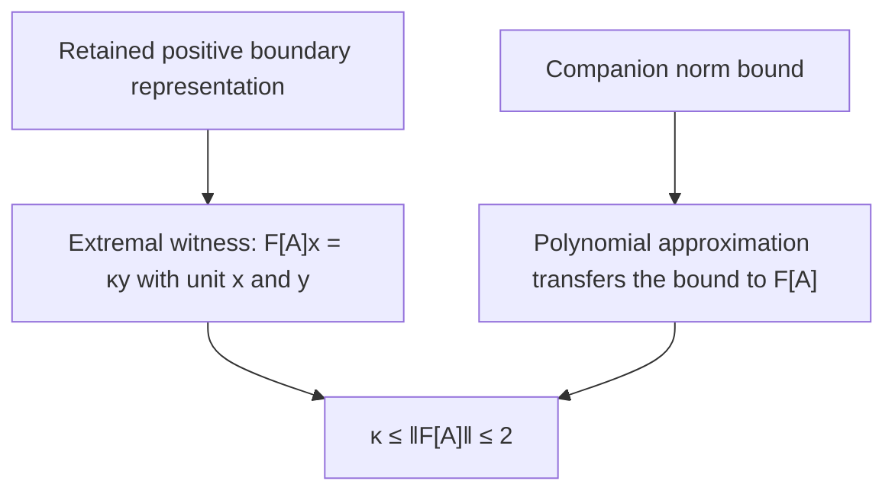

# A more direct endpoint in the complete Crouzeix proof

**Result:** A replacement argument for the [September 23 structural proof](https://mathcommunity.github.io/oai-math-revised/papers/The-complete-Crouzeix-theorem-September-23-2026/) keeps the same theorem and positive boundary representation, while reducing the full manuscript from 22 to 21 pages under the same typesetting.

**Key step:** The original witness satisfies $F[A]x=\kappa y$ for unit vectors $x,y$. A polynomial approximation transfers the companion norm bound to $F[A]$, giving $\kappa\leq\lVert F[A]\rVert\leq2$ without the separate density-matching and cross-term argument.

**Read just what changed:** [3-page comparison note (PDF)](https://github.com/hys-ops/crouzeix-proof-followup/blob/54bde9823708fe2ad89dd7ebaa803806139c2815/Crouzeix_Endpoint_Review.pdf) contrasts the two proof routes. For the actual replacement argument, read [the 21-page proof (PDF)](https://github.com/hys-ops/crouzeix-proof-followup/blob/54bde9823708fe2ad89dd7ebaa803806139c2815/Crouzeix_Restored_Gaussian_21p.pdf), §§3–5 (pp. 8–13). The final endpoint step is in §5 (pp. 12–13).

## What the replacement uses

Both inputs meet at the final inequality. The replacement bypasses density matching and the cross-term argument; it does not change the theorem.

[Reproduction kit (ZIP)](https://github.com/hys-ops/crouzeix-proof-followup/blob/54bde9823708fe2ad89dd7ebaa803806139c2815/Crouzeix_Restored_Review_Kit.zip) · [Community submission #84](https://github.com/mathcommunity/oai-math-revised/issues/84)

This is a proof comparison, not a new theorem. OpenAI authored the original manuscripts; ChatGPT/Codex assisted with the comparison, writing and reproduction materials. The revised proof has not been fully formalized in Lean or independently reviewed by a human.
